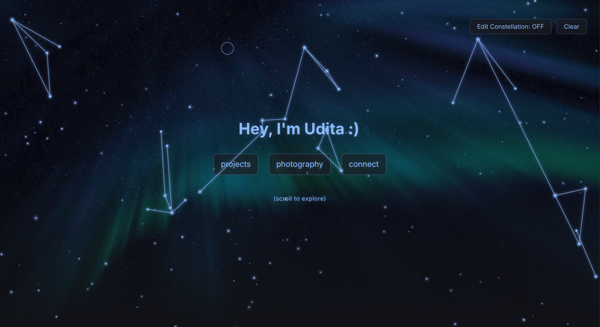

# Personal Website 

A personal website to showcase my projects, interests, and the random things I'm curious about. I wanted to build something that wasn't just another tech portfolio, but a place to showcase the things I make while sharing a little about the person behind them. :)

**[Visit My Space](https://uditaspace.com)**

## Highlights

- **About Me:** A little introduction to who I am and what drives my curiosity.
- **Interests:** A collection of things I'm into, from coding and robotics to art and the cosmos.
- **Projects:** Things I've built, experimented with, or learned along the way.
- **Photography:** Photos I've taken.

## Tech Stack

- HTML
- CSS
- JavaScript
- `localStorage`

  

## Note 

I've been wanting to build a personal website for quite a while, and finally got around to it when I came across Hackclub Stardance. I decided to build it around my fascination with space. I had a lot of fun putting it together and experimenting with css animations, canvas, and different visual effects. Honestly, I don't think this project will ever really be "finished" as I'll probably keep adding to it as I build more things and explore new interests. :] (and big thank you to the Stardance team for the domain grant that made this possible!)

<em>AI assistance was used to explore the background star effects, the connection and formation of constellations, to write the code connecting Discord to JavaScript for receiving messages without a complicated backend, and to understand CSS media queries.</em>